# Architecture documentation

PlantUML sources live in [`architecture/`](architecture/); rendered SVGs are in
[`rendered/`](rendered/). All diagrams share the styling in
[`architecture/style.iuml`](architecture/style.iuml). The same diagrams, with a short
explanation of each, are collected into a single PDF by [`architecture.tex`](architecture.tex).

## Building

```sh
docs/build.sh             # SVGs + docs/build/architecture.pdf
docs/build.sh --svg-only  # only refresh docs/rendered/*.svg
```

The script:

1. renders every `architecture/*.puml` to `rendered/*.svg`, using a local `plantuml` or,
   failing that, the `plantuml/plantuml` Docker image;
2. converts the SVGs to vector PDFs in `build/figures/` with `rsvg-convert` (or `inkscape`);
3. compiles `architecture.tex` with `latexmk`/`pdflatex` into **`build/architecture.pdf`**,
   stamped with the current `git describe` revision.

Steps 2 and 3 need librsvg and a TeX Live installation (on Fedora: `librsvg2-tools`,
`latexmk`, `texlive-scheme-medium`). `docs/build/` is git-ignored; the SVGs in `rendered/`
are committed so the diagrams below show up on GitHub. Re-run the script after editing a
`.puml` file so they stay current.

Editor previews also work: the VS Code "PlantUML" extension and the IntelliJ PlantUML plugin
both resolve the relative `!include`.

### Adding a diagram

Create `architecture/NN-name.puml` starting with `@startuml <output-name>` and
`!include style.iuml`, then add a section to `architecture.tex` using `\diagram{<output-name>}{caption}`
for a portrait page, or `\widediagram{...}` inside a `landscape` environment for wide diagrams,
and add it to the table below.

## Diagrams

| # | Diagram | Type | Shows |
|---|---|---|---|
| 1 | [System context](architecture/01-system-context.puml) | use case | Clients, the API and PostgreSQL |
| 2 | [Deployment](architecture/02-deployment.puml) | deployment | Docker Compose services, network, volume, test DB |
| 3 | [Components](architecture/03-components.puml) | component | Crate modules and how they depend on each other |
| 4 | [Request pipeline](architecture/04-request-pipeline.puml) | activity | Tower layers, extractors, handler, error mapping |
| 5 | [Register](architecture/05-seq-register.puml) | sequence | `POST /auth/register` |
| 6 | [Login](architecture/06-seq-login.puml) | sequence | `POST /auth/login`, including the timing-safe dummy hash |
| 7 | [Update a todo](architecture/07-seq-todo-update.puml) | sequence | `PATCH /todos/{id}`: auth, validation, ownership check |
| 8 | [Data model](architecture/08-data-model.puml) | ER | `users` and `todos` tables |
| 9 | [Models](architecture/09-models.puml) | class | Request and response types and their validated forms |
| 10 | [Errors and state](architecture/10-errors-and-state.puml) | class | `AppError` to HTTP status, `Config`, `AppState`, JWT claims |
| 11 | [Lifecycle](architecture/11-lifecycle.puml) | activity | Startup, migrations, graceful shutdown |
| 12 | [Test layout](architecture/12-test-layout.puml) | component | Test suites and what each exercises |

### 1. System context
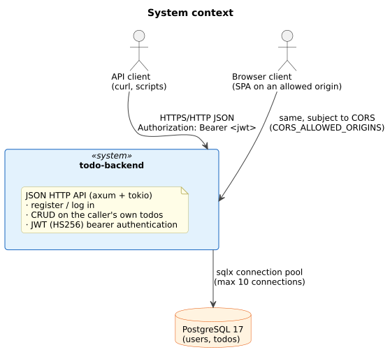

### 2. Deployment
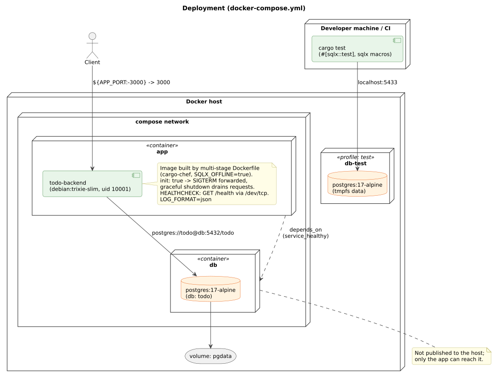

### 3. Components
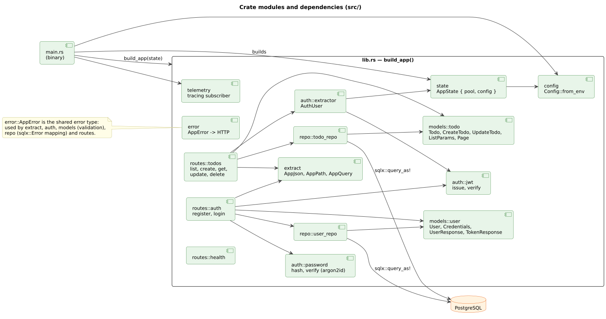

### 4. Request pipeline
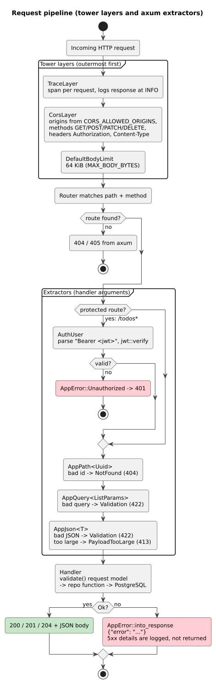

### 5. Register
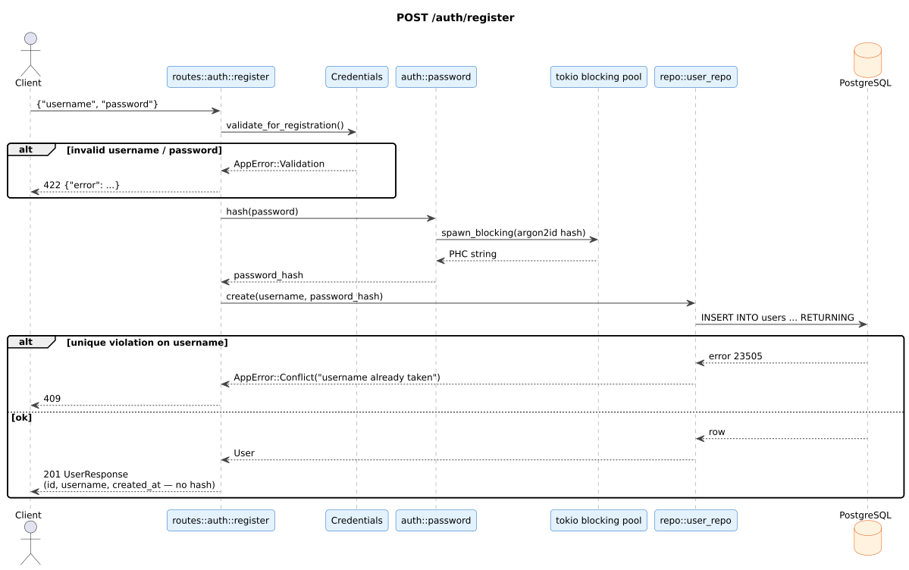

### 6. Login
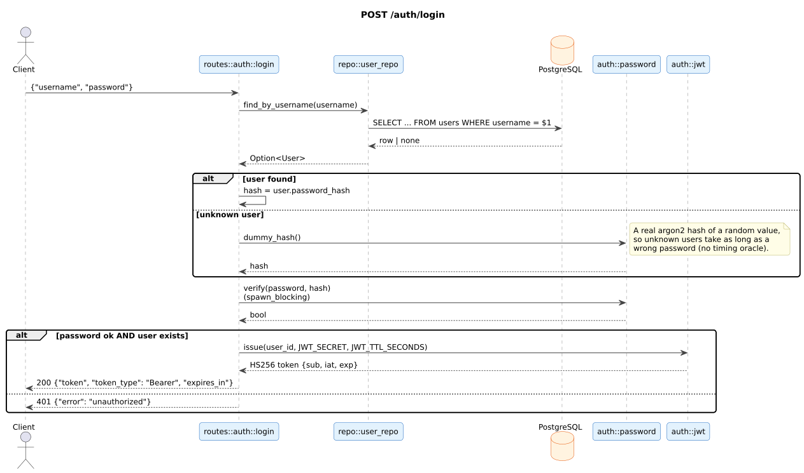

### 7. Update a todo
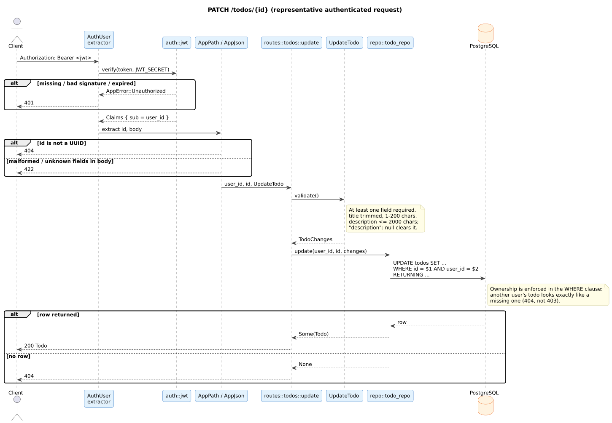

### 8. Data model
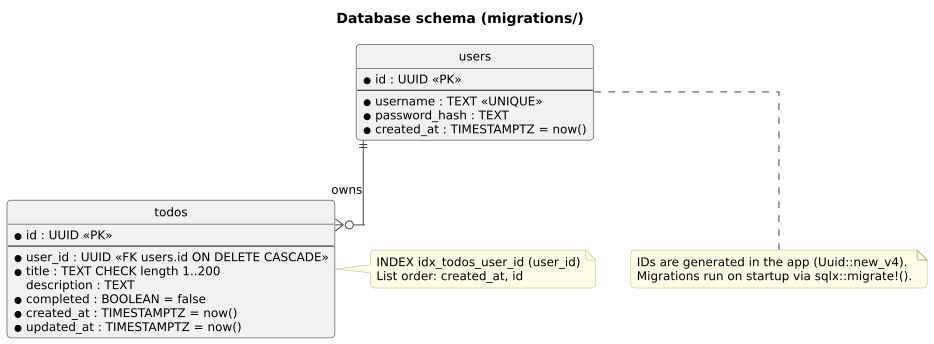

### 9. Models
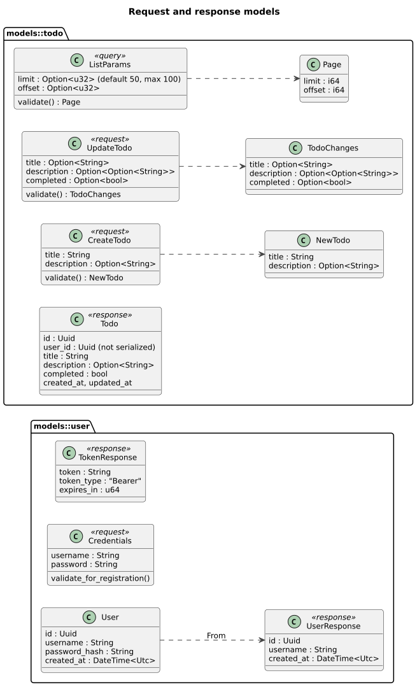

### 10. Errors and state
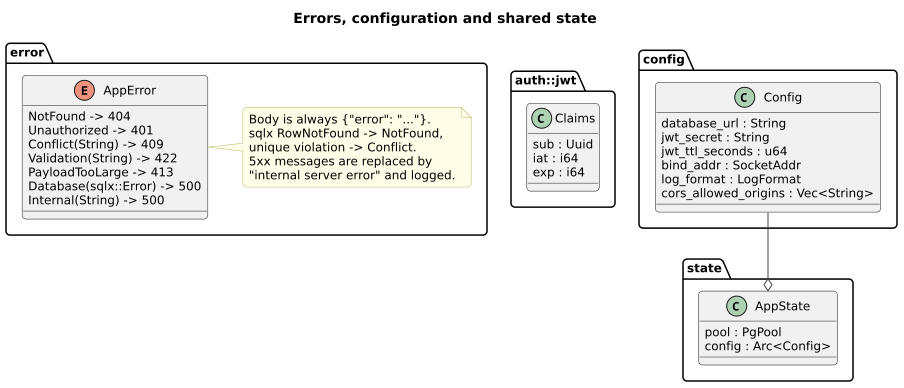

### 11. Lifecycle
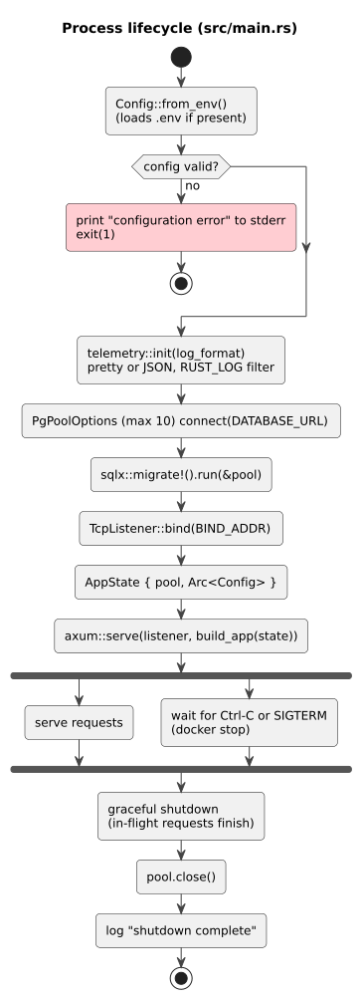

### 12. Test layout
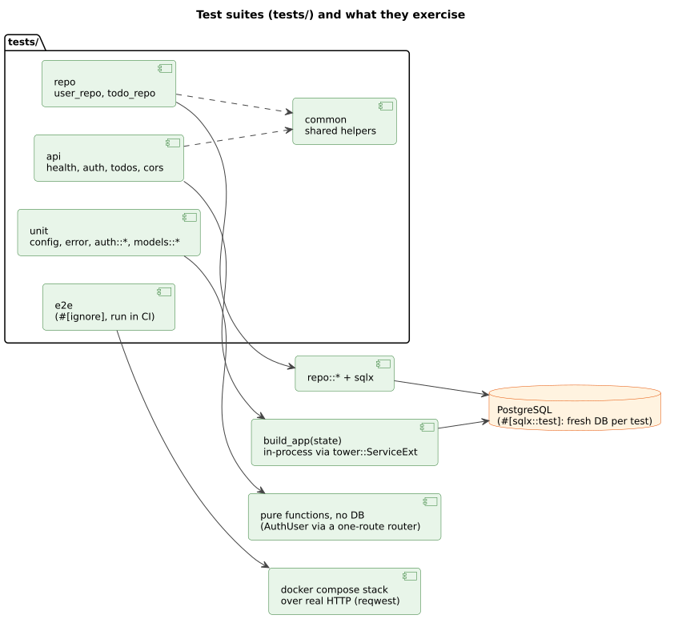
